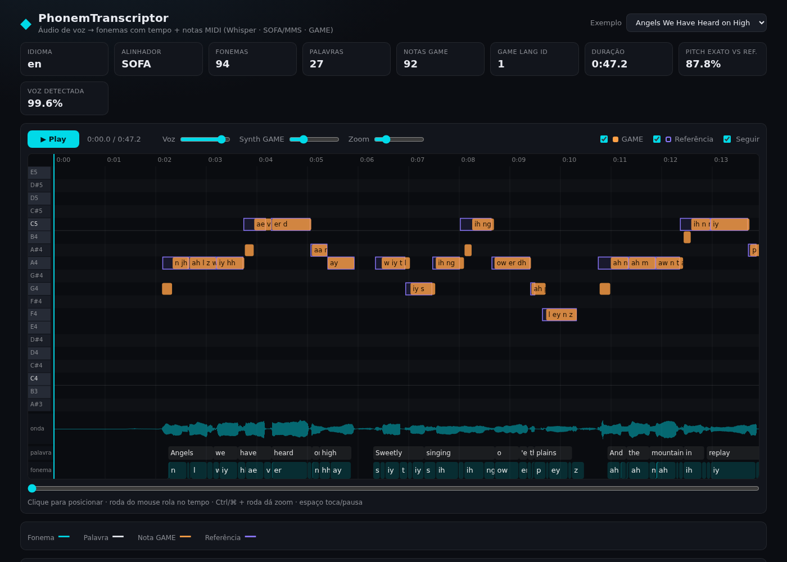
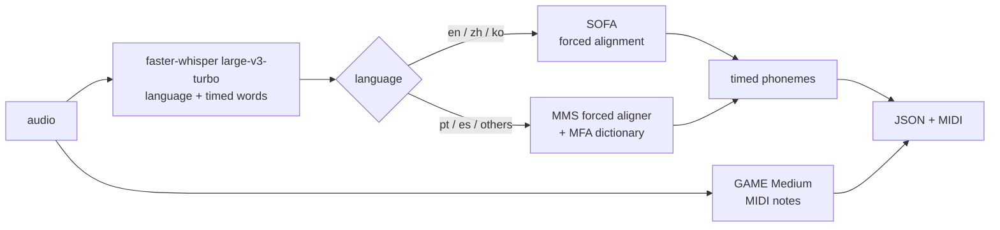

# PhonemTranscriptor

**English** · [Português](README.pt-BR.md)

Takes a sung vocal (a cappella or a separated stem) and returns:

- **timed phonemes** (start/end of each phoneme, with the word it belongs to);
- **MIDI notes** of the melody transcribed by [GAME](https://github.com/openvpi/GAME), each note carrying the phonemes that fall on it;
- a **`.mid`** file with the notes and the phonemes written as `lyrics` events.

**Interactive demo:** [`docs/`](docs/). Run `cd docs && python -m http.server 8000` and open <http://localhost:8000>.



## How it works



1. **ASR**: `faster-whisper` (`large-v3-turbo`) detects the language and transcribes timed words. It runs with `condition_on_previous_text=False` and VAD, so instrumental bridges don't get filled with repeated lyrics.
2. **Phoneme alignment**, per language:

   | Language | Aligner | Phonemes | Model / dictionary |
   |---|---|---|---|
   | en | SOFA | ARPAbet | `tgm_en_v100.ckpt` (spicytigermeat) |
   | zh | SOFA | pinyin (opencpop) | `v1.0.0_mandarin_singing.ckpt` |
   | ko | SOFA | hangul table | `korean-v2.0-12000.ckpt` (colstone) |
   | pt, es | MMS (torchaudio) | IPA (MFA) | `portuguese_mfa.dict`, `spanish_mfa.dict` |
   | others | MMS | romanization (uroman) | — |

3. **Notes**: GAME Medium transcribes the melody. Post-processing matches the PitchNet editor: it drops rests and short notes, then refines the note edges with VAD. GAME runs in a subprocess (`game_worker.py`) because it and SOFA both ship top-level packages with the same names (`lib`, `modules`).
4. **Merge**: each phoneme is attached to the note it overlaps most in time.

## Example

[`examples/`](examples/) has a 47 s excerpt of *Angels We Have Heard on High* (traditional, public domain), recorded for the [Children's Song Dataset](https://zenodo.org/records/4785016) (CSD `en002a`, CC BY-NC-SA 4.0).

| File | Content |
|---|---|
| `angels.wav` | input (mono, 44.1 kHz) |
| `angels.json` | CLI output |
| `angels.mid` | GAME notes + phonemes as `lyrics` |
| `angels.reference.json` | CSD reference score, for comparison |

Against the CSD reference, GAME gets the exact pitch on **87.8 %** of sung frames and detects voice on **99.6 %** of them.

```bash
phonem-transcriptor examples/angels.wav -o examples/angels.json
# en via sofa: 94 fonemas, GAME lang 1, 92 notas -> examples/angels.json | examples/angels.mid
```

## Layout

```
phonem_transcriptor/      package
  cli.py                  `phonem-transcriptor` CLI
  pipeline.py             transcribe(): Whisper -> SOFA/MMS -> GAME
  whisper_asr.py          faster-whisper
  routing.py              picks SOFA or MMS per language
  sofa_align.py           SOFA alignment (en/zh/ko)
  mms_align.py, phones.py MMS alignment + dictionary phonemes (pt/es/...)
  g2p.py                  dictionaries and romanization
  game_midi.py            runs the worker, merges notes and phonemes, writes the .mid
  game_worker.py          GAME subprocess
  game_transcribe.py      GAME Medium inference
  game_postprocess.py     note post-processing (PitchNet port)
  game_lang.py            Whisper language -> GAME language id
  download.py             downloads the models into models/
third_party/
  SOFA/                   qiuqiao/SOFA v1.0.3 (MIT), unmodified
  GAME/                   openvpi/GAME (MIT), unmodified
tests/                    unit tests (unittest)
examples/                 example audio + output
docs/                     static demo (GitHub Pages)
models/                   checkpoints (not in git)
```

## Installation

Python 3.11 and PyTorch with CUDA (tested with torch/torchaudio 2.5.1+cu121 on an A100). It also runs on CPU, just much slower.

```bash
conda create -n phonem python=3.11 -y
conda activate phonem
pip install torch==2.5.1 torchaudio==2.5.1 --index-url https://download.pytorch.org/whl/cu121
pip install -e .
```

## Models

The checkpoints (~4.8 GB) live in `models/`, outside git. There are two ways to get them.

### Option A: Google Drive (everything at once)

Folder: **[PhonemTranscriptor/models](https://drive.google.com/drive/folders/1xmtJ2XSF4XHEY7j4p9WJAkI3zM-ULkb9)**

It mirrors `models/` with every file already in place:

```
models/
  GAME-1.0-medium/{model.pt, config.yaml, lang_map.json}
  sofa/{en,zh,ko}/{model.ckpt, dictionary.txt}
  dictionaries/{portuguese_mfa.dict, spanish_mfa.dict}
  whisper/models--mobiuslabsgmbh--faster-whisper-large-v3-turbo/...
  torch/hub/checkpoints/model.pt          # MMS_FA (torchaudio)
```

```bash
pip install gdown
gdown --folder https://drive.google.com/drive/folders/1xmtJ2XSF4XHEY7j4p9WJAkI3zM-ULkb9 -O .   # creates ./models
# or, with rclone access to the account:
rclone copy gdrive:PhonemTranscriptor/models models
```

### Option B: original sources

```bash
python -m phonem_transcriptor.download
```

Downloads each model from its origin: Whisper (Hugging Face), SOFA en/zh/ko (GitHub releases), MFA dictionaries, MMS (torchaudio) and GAME Medium ([openvpi/GAME v1.0.0](https://github.com/openvpi/GAME/releases/tag/v1.0.0)). When it finishes, it writes `models/manifest.json`.

## Usage

```bash
phonem-transcriptor vocal.wav -o out.json            # language auto-detected
phonem-transcriptor vocal.wav -o out.json --lang pt  # force language (auto, en, pt, es, zh, ko)
```

Writes `out.json` and `out.mid`.

```python
from phonem_transcriptor import transcribe

result = transcribe("vocal.wav", language="auto", midi_path="vocal.mid")
```

### Output format

```jsonc
{
  "language": "en",
  "aligner": "sofa",                 // "sofa" or "mms"
  "phonemes": [
    {"phoneme": "ey", "start": 2.112, "end": 2.301, "word": "Angels"}
    // MMS may add "phoneme_source": "romanized" when the word is not in the dictionary
  ],
  "game": {
    "language_id": 1,                // language id used by GAME (0 = universal)
    "model": "GAME-1.0-medium",
    "midi": "out.mid",
    "notes": [
      {"pitch": 69, "onset": 2.14, "offset": 2.65, "velocity": 80,
       "phonemes": ["ey", "n"], "words": ["Angels"]}
    ]
  }
}
```

### Environment variables

| Variable | Purpose |
|---|---|
| `PHONEM_GAME_MODEL` | alternative GAME checkpoint folder (default `models/GAME-1.0-medium`) |
| `PHONEM_GAME_PYTHON` | alternative interpreter for the GAME worker (default: the same Python) |

GAME samples note boundaries with diffusion (D3PM). `transcribe_wav` fixes `seed=0`, so the output repeats across runs.

## Tests

```bash
python -m unittest discover -s tests
```

## Demo (GitHub Pages)

`docs/` is a static site with no build step: a piano roll with the GAME and reference notes, waveform, word and phoneme lanes, a note synth, zoom and click-to-seek. Examples are listed in `docs/examples/manifest.json`.

To add an example, generate the output with the CLI, copy the audio (preferably MP3) and the JSON into `docs/examples/`, and add an entry to the manifest. The `reference` field is optional. To try it locally:

```bash
cd docs && python -m http.server 8000
```

In the repository settings, Pages publishes from `main` / `docs`.

## Limitations

- Lyrics depend on Whisper. Long melismas and Latin (*"Gloria in excelsis Deo"* in the example) can end up with no phonemes or the wrong word.
- With MMS (pt/es), phonemes inherit the timing of the aligned letters and last ~20 ms. SOFA gives real durations.
- GAME Medium only has trained language embeddings for en, ja, yue and zh. Other languages use the universal embedding (id 0).

## Licenses and credits

- Code in this repository: see the licenses of the bundled components below.
- [SOFA](https://github.com/qiuqiao/SOFA): MIT. Checkpoints: [spicytigermeat/SOFA-Models](https://github.com/spicytigermeat/SOFA-Models) (en), [qiuqiao/SOFA](https://github.com/qiuqiao/SOFA/releases) (zh), [colstone/SOFA_Models](https://github.com/colstone/SOFA_Models) (ko).
- [GAME](https://github.com/openvpi/GAME): MIT, Team OpenVPI.
- `game_postprocess.py` is a port of the `EditorController` from [PitchNet](https://github.com/SessionLoops/PitchNet), which is **AGPL-3.0**.
- [faster-whisper](https://github.com/SYSTRAN/faster-whisper) (MIT); weights [`mobiuslabsgmbh/faster-whisper-large-v3-turbo`](https://huggingface.co/mobiuslabsgmbh/faster-whisper-large-v3-turbo) (MIT).
- [MMS forced aligner](https://pytorch.org/audio/stable/pipelines.html#torchaudio.pipelines.MMS_FA): weights CC BY-NC 4.0.
- [MFA](https://github.com/MontrealCorpusTools/mfa-models) dictionaries: CC BY 4.0.
- Example audio: [Children's Song Dataset](https://zenodo.org/records/4785016), CC BY-NC-SA 4.0.
