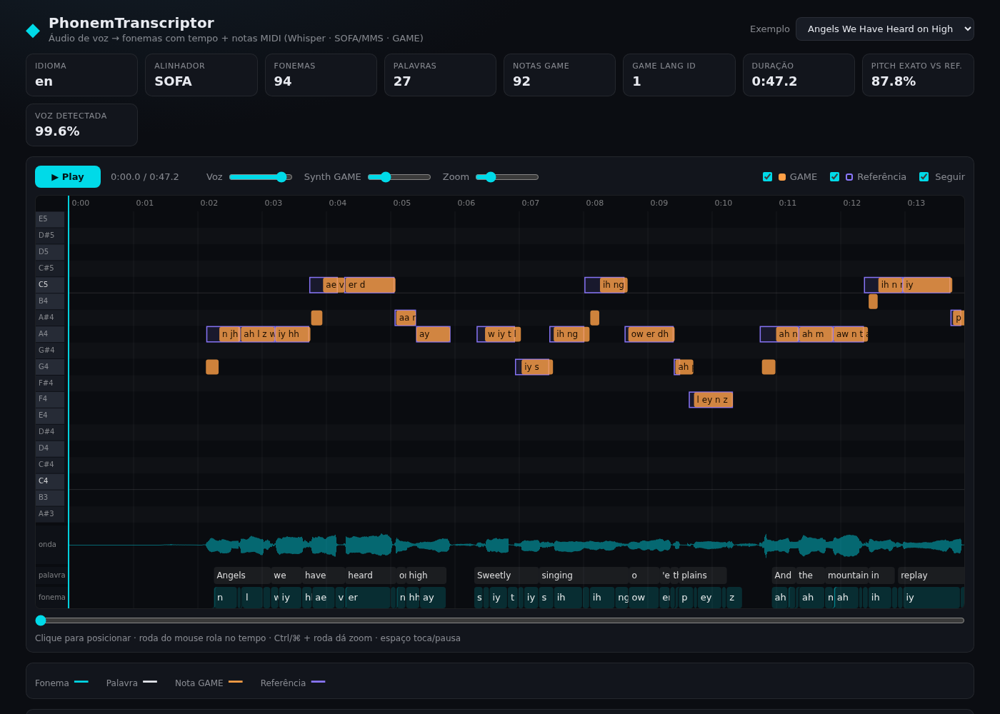
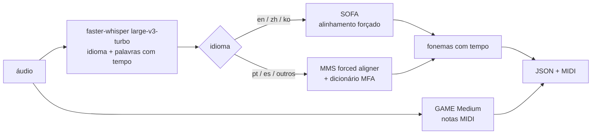

# PhonemTranscriptor

[English](README.md) · **Português**

Recebe o áudio de uma voz cantada (a cappella ou stem separado) e devolve:

- **fonemas com tempo** (início/fim de cada fonema, com a palavra de origem);
- **notas MIDI** da melodia transcritas pelo [GAME](https://github.com/openvpi/GAME), cada nota com os fonemas que caem nela;
- um **`.mid`** com as notas e os fonemas gravados como eventos `lyrics`.

**Demo interativa:** [`docs/`](docs/). Rode `cd docs && python -m http.server 8000` e abra <http://localhost:8000>.



## Como funciona



1. **ASR** — `faster-whisper` (`large-v3-turbo`) detecta o idioma e transcreve as palavras com tempo. Usa `condition_on_previous_text=False` e VAD para não repetir a letra em trechos instrumentais.
2. **Alinhamento de fonemas** — por idioma:

   | Idioma | Alinhador | Fonemas | Modelo / dicionário |
   |---|---|---|---|
   | en | SOFA | ARPAbet | `tgm_en_v100.ckpt` (spicytigermeat) |
   | zh | SOFA | pinyin (opencpop) | `v1.0.0_mandarin_singing.ckpt` |
   | ko | SOFA | hangul table | `korean-v2.0-12000.ckpt` (colstone) |
   | pt, es | MMS (torchaudio) | IPA (MFA) | `portuguese_mfa.dict`, `spanish_mfa.dict` |
   | outros | MMS | romanização (uroman) | — |

3. **Notas** — o GAME Medium transcreve a melodia. O pós-processamento é o mesmo do editor do PitchNet: descarta pausas e notas curtas e refina as bordas com VAD. O GAME roda em um subprocesso (`game_worker.py`), porque ele e o SOFA têm pacotes de topo com o mesmo nome (`lib`, `modules`).
4. **Junção** — cada fonema é associado à nota com que mais se sobrepõe no tempo.

## Exemplo

[`examples/`](examples/) traz um trecho de 47 s de *Angels We Have Heard on High* (canção tradicional, domínio público), gravado pelo [Children's Song Dataset](https://zenodo.org/records/4785016) (CSD `en002a`, CC BY-NC-SA 4.0).

| Arquivo | Conteúdo |
|---|---|
| `angels.wav` | entrada (mono, 44.1 kHz) |
| `angels.json` | saída da CLI |
| `angels.mid` | notas GAME + fonemas como `lyrics` |
| `angels.reference.json` | partitura de referência do CSD, para comparar |

Contra a referência do CSD, o GAME acerta a altura exata em **87.8 %** dos quadros cantados e detecta voz em **99.6 %** deles.

```bash
phonem-transcriptor examples/angels.wav -o examples/angels.json
# en via sofa: 94 fonemas, GAME lang 1, 92 notas -> examples/angels.json | examples/angels.mid
```

## Estrutura

```
phonem_transcriptor/      pacote
  cli.py                  CLI `phonem-transcriptor`
  pipeline.py             transcribe(): Whisper -> SOFA/MMS -> GAME
  whisper_asr.py          faster-whisper
  routing.py              escolhe SOFA ou MMS por idioma
  sofa_align.py           alinhamento SOFA (en/zh/ko)
  mms_align.py, phones.py alinhamento MMS + fonemas do dicionário (pt/es/...)
  g2p.py                  dicionários e romanização
  game_midi.py            chama o worker, junta notas e fonemas, escreve o .mid
  game_worker.py          subprocesso do GAME
  game_transcribe.py      inferência do GAME Medium
  game_postprocess.py     pós-processamento das notas (porte do PitchNet)
  game_lang.py            idioma Whisper -> id de idioma do GAME
  download.py             baixa os modelos em models/
third_party/
  SOFA/                   qiuqiao/SOFA v1.0.3 (MIT), sem alterações
  GAME/                   openvpi/GAME (MIT), sem alterações
tests/                    testes unitários (unittest)
examples/                 áudio de exemplo + saída
docs/                     demo estática (GitHub Pages)
models/                   checkpoints (fora do git)
```

## Instalação

Python 3.11 e PyTorch com CUDA (testado com torch/torchaudio 2.5.1+cu121, numa A100). Também roda em CPU, só que bem mais devagar.

```bash
conda create -n phonem python=3.11 -y
conda activate phonem
pip install torch==2.5.1 torchaudio==2.5.1 --index-url https://download.pytorch.org/whl/cu121
pip install -e .
```

## Modelos

Os checkpoints (~4.8 GB) ficam em `models/`, fora do git. Há duas formas de obtê-los.

### Opção A — Google Drive (tudo de uma vez)

Pasta: **[PhonemTranscriptor/models](https://drive.google.com/drive/folders/1xmtJ2XSF4XHEY7j4p9WJAkI3zM-ULkb9)**

Ela espelha `models/` com os arquivos já no lugar:

```
models/
  GAME-1.0-medium/{model.pt, config.yaml, lang_map.json}
  sofa/{en,zh,ko}/{model.ckpt, dictionary.txt}
  dictionaries/{portuguese_mfa.dict, spanish_mfa.dict}
  whisper/models--mobiuslabsgmbh--faster-whisper-large-v3-turbo/...
  torch/hub/checkpoints/model.pt          # MMS_FA (torchaudio)
```

```bash
pip install gdown
gdown --folder https://drive.google.com/drive/folders/1xmtJ2XSF4XHEY7j4p9WJAkI3zM-ULkb9 -O .   # cria ./models
# ou, com acesso à conta via rclone:
rclone copy gdrive:PhonemTranscriptor/models models
```

### Opção B — fontes originais

```bash
python -m phonem_transcriptor.download
```

Baixa cada modelo da sua origem: Whisper (Hugging Face), SOFA en/zh/ko (GitHub releases), dicionários MFA, MMS (torchaudio) e GAME Medium ([openvpi/GAME v1.0.0](https://github.com/openvpi/GAME/releases/tag/v1.0.0)). Ao terminar, grava `models/manifest.json`.

## Uso

```bash
phonem-transcriptor voz.wav -o saida.json            # idioma detectado
phonem-transcriptor voz.wav -o saida.json --lang pt  # força o idioma (auto, en, pt, es, zh, ko)
```

Gera `saida.json` e `saida.mid`.

```python
from phonem_transcriptor import transcribe

result = transcribe("voz.wav", language="auto", midi_path="voz.mid")
```

### Formato da saída

```jsonc
{
  "language": "en",
  "aligner": "sofa",                 // "sofa" ou "mms"
  "phonemes": [
    {"phoneme": "ey", "start": 2.112, "end": 2.301, "word": "Angels"}
    // MMS pode incluir "phoneme_source": "romanized" quando a palavra não está no dicionário
  ],
  "game": {
    "language_id": 1,                // id de idioma usado no GAME (0 = universal)
    "model": "GAME-1.0-medium",
    "midi": "saida.mid",
    "notes": [
      {"pitch": 69, "onset": 2.14, "offset": 2.65, "velocity": 80,
       "phonemes": ["ey", "n"], "words": ["Angels"]}
    ]
  }
}
```

### Variáveis de ambiente

| Variável | Uso |
|---|---|
| `PHONEM_GAME_MODEL` | outra pasta de checkpoint do GAME (padrão `models/GAME-1.0-medium`) |
| `PHONEM_GAME_PYTHON` | outro interpretador para o worker do GAME (padrão: o mesmo Python) |

O GAME amostra as bordas das notas por difusão (D3PM). `transcribe_wav` fixa `seed=0`, então a saída se repete entre execuções.

## Testes

```bash
python -m unittest discover -s tests
```

## Demo (GitHub Pages)

`docs/` é um site estático, sem build: piano roll com as notas do GAME e da referência, forma de onda, faixas de palavras e fonemas, synth das notas, zoom e clique para posicionar. Os exemplos são listados em `docs/examples/manifest.json`.

Para adicionar um exemplo, gere a saída com a CLI, copie o áudio (MP3 de preferência) e o JSON para `docs/examples/` e acrescente uma entrada no manifesto. O campo `reference` é opcional. Para testar localmente:

```bash
cd docs && python -m http.server 8000
```

Nas configurações do repositório, o Pages publica a partir de `main` / `docs`.

## Limitações

- A letra depende do Whisper. Melismas longos e latim (*"Gloria in excelsis Deo"* no exemplo) podem sair sem fonemas ou com a palavra errada.
- No MMS (pt/es), os fonemas herdam o tempo das letras alinhadas e ficam com ~20 ms. O SOFA dá durações reais.
- O GAME Medium só tem embedding treinado para en, ja, yue e zh. Os outros idiomas usam o embedding universal (id 0).

## Licenças e créditos

- Código deste repositório: veja abaixo as licenças dos componentes incorporados.
- [SOFA](https://github.com/qiuqiao/SOFA) — MIT. Checkpoints: [spicytigermeat/SOFA-Models](https://github.com/spicytigermeat/SOFA-Models) (en), [qiuqiao/SOFA](https://github.com/qiuqiao/SOFA/releases) (zh), [colstone/SOFA_Models](https://github.com/colstone/SOFA_Models) (ko).
- [GAME](https://github.com/openvpi/GAME) — MIT, Team OpenVPI.
- `game_postprocess.py` é um porte do `EditorController` do [PitchNet](https://github.com/SessionLoops/PitchNet), que é **AGPL-3.0**.
- [faster-whisper](https://github.com/SYSTRAN/faster-whisper) (MIT); pesos [`mobiuslabsgmbh/faster-whisper-large-v3-turbo`](https://huggingface.co/mobiuslabsgmbh/faster-whisper-large-v3-turbo) (MIT).
- [MMS forced aligner](https://pytorch.org/audio/stable/pipelines.html#torchaudio.pipelines.MMS_FA) — pesos CC BY-NC 4.0.
- Dicionários [MFA](https://github.com/MontrealCorpusTools/mfa-models) — CC BY 4.0.
- Áudio de exemplo: [Children's Song Dataset](https://zenodo.org/records/4785016) — CC BY-NC-SA 4.0.
